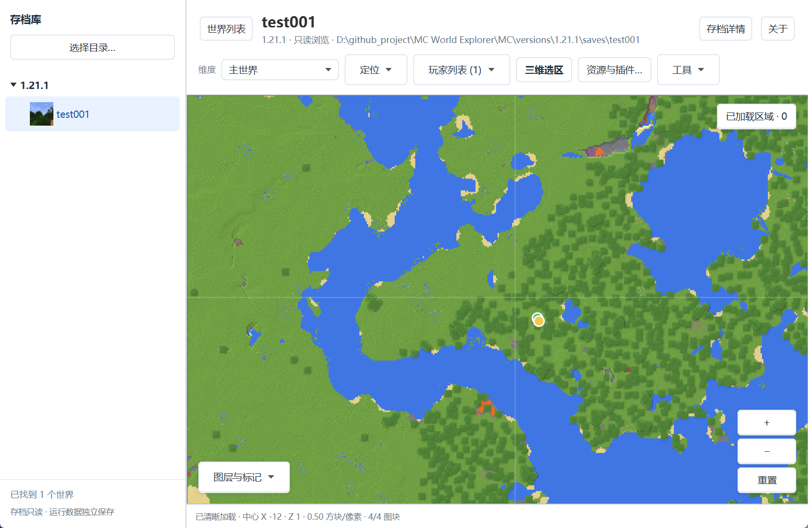
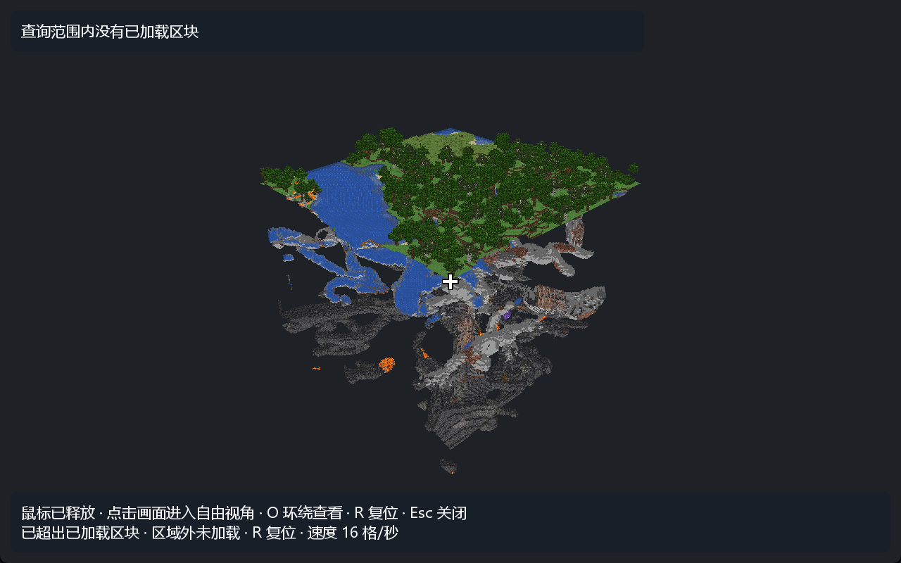
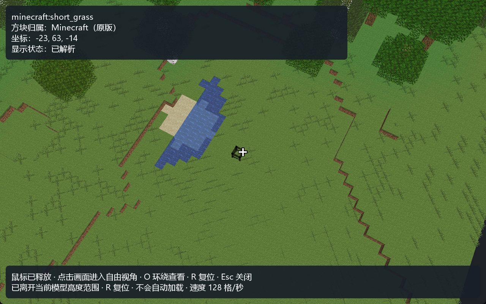

  

<h1 align="center">MC World Explorer</h1>

无需启动 Minecraft，浏览你的 Java 版存档、地图和三维场景。

  
  
  

  <strong><a href="https://github.com/huang3337/MC-World-Explorer/releases/latest">下载 Windows 便携版</a></strong>
  ·
  <strong><a href="docs/README.md">使用与开发文档</a></strong>

## 可以做什么

- **整理存档**：扫描游戏目录、整合包实例或单个世界，查看版本、种子、游玩时间和保存位置。
- **浏览地图**：在主世界、下界、末地及可识别的 Mod 维度间切换，拖动缩放地图，查看地表或洞穴高度带。
- **找回位置**：按 X/Z 坐标跳转，查看玩家、出生点和已加载地图内的下界传送门。
- **查看三维场景**：从二维地图选择有限区块范围，在独立窗口里查看建筑和地形。
- **保存地图图片**：将当前二维视口导出为 PNG，方便记录或分享。

浏览过程只读存档。程序配置、缓存、日志和导出文件与 Minecraft 世界数据分开保存。

## 实际效果

以下为 **0.7.4 的实际界面**，使用 Minecraft **1.21.1** 的 `test001` 存档。

**二维地图**：拖动、缩放，连续浏览存档中已生成的区域，地图内容随视野按需加载。

**三维预览**：查看选区内的地表与洞穴，在已加载选区内自由移动、转向和升降。

查看三维近景与方块信息

准星与线框帮助确认目标方块，并显示原始 ID、归属、坐标和显示状态。

## 下载

从 [最新正式 Release](https://github.com/huang3337/MC-World-Explorer/releases/latest) 下载 Windows 便携版及校验文件。开发源码与正式软件包可能处于不同阶段；版本与状态入口统一见上方“使用与开发文档”。

### 浏览与诊断

- **资源与纹理**：使用所选游戏目录和资源包中的常见模型与纹理，显示地形与建筑的原有外观。
- **自由视角**：在已加载场景内使用 WASD 和鼠标浏览，升降、释放鼠标及恢复视角；准星与选中线框帮助确认目标方块。
- **方块信息与解析诊断**：查看方块 ID、归属、坐标及显示状态；按 Mod 查看本次选区的问题、资源来源，并导出报告。
- **清楚的功能分区**：“资源与插件”分为资源、解析诊断和插件三页。可以安装、启停和卸载可信的第三方解析插件，应用不附带任何插件。

目前无法完整显示所有 Mod 的模型和颜色。遇到不支持的内容，程序会保留方块身份并说明原因。三维移动限于已加载选区，不会随着相机移动自动加载新区块。诊断只代表本次实际生成的区域。

## 快速开始

1. 从本仓库的 [Releases 页面](https://github.com/huang3337/MC-World-Explorer/releases) 下载 Windows x64 便携版 ZIP。
2. **完整解压**到普通文件夹，双击 `MC World Explorer.exe`。便携版无需另装 Java。
3. 点击选择目录按钮，选择 Minecraft 游戏目录、实例、存档目录或单个世界。
4. 在左侧选择世界，通过地图上的维度、定位和图层工具浏览。
5. 打开三维选区，选择范围并生成预览。第一次使用建议从较小范围开始。

保留 EXE、`app` 和 `runtime` 的相对位置，不要直接在压缩包内运行。配置、缓存、日志和导出文件位于程序目录中的 `config/`、`cache/`、`logs/` 和 `exports/`。

### 三维操作

在二维地图中锁定选区后，方框保持在所选区块：加载时为蓝色，成功后为绿色。点击“取消生成”或“取消选区”可重新选择位置，地图仍可拖动和缩放。

**V0.6.0 历史版**：左键拖动旋转，右键拖动平移旋转中心，滚轮缩放；`R` 复位，`Esc` 关闭三维窗口。

**V0.7.4**：点击画面捕获鼠标，`W/A/S/D` 移动，鼠标转向，`Space` 上升、`Shift` 下降；`Alt` 切换捕获与释放，`Esc` 释放鼠标，已释放时再按 `Esc` 关闭三维窗口；`O` 切换环绕模式，`R` 复位。切走窗口后释放输入，回来点击画面继续。

主界面右上角“关于”可查看版本、作者和项目主页，并复制工具信息。

## 反馈问题

可在仓库的 [Issues](https://github.com/huang3337/MC-World-Explorer/issues) 描述问题。请注明应用版本、Minecraft 版本、复现步骤，以及实际与预期表现；0.7.4 的资源问题可以附上相关诊断条目。分享前检查报告中的本机路径，不必上传完整存档或 Mod 文件。

## 技术与许可

使用 Java 21、JavaFX、LWJGL/OpenGL 和 Gradle，主界面与三维窗口独立运行。项目采用 [GNU GPL v3.0](LICENSE) 许可证。
