

<h1 align="center">MC World Explorer</h1>

在游戏外打开 Minecraft Java 版存档，沿着二维地图找路，再走进选中的三维场景。

<a href="https://gitee.com/huang3337/MC-World-Explorer/releases/latest"><strong>国内镜像下载（Gitee）</strong></a> · <a href="https://github.com/huang3337/MC-World-Explorer/releases/latest"><strong>GitHub 下载</strong></a> · <a href="docs/README.md">使用文档</a> · <a href="docs/SDK_GUIDE.md">开发者 SDK</a> · <a href="docs/PLUGIN_DEVELOPMENT.md#agent-prompt">AI 扩展构建提示词</a> · <a href="docs/releases/V0.8.1.md">0.8.1 版本说明</a>

## 从河湾找到村庄

在二维地图上，沿着河岸就能找到村庄的道路和农田。打开「三维选区」，沿地图拖出一个方框，再点「生成三维预览」，就能从高处看清同一条路通向哪栋房子。

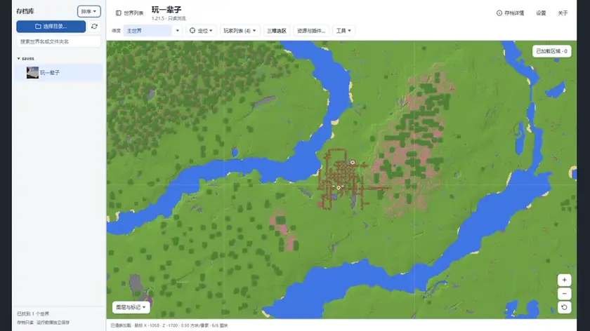

这段画面取自 Java 版 1.21.5 的真实存档「玩一辈子」。增强档加载了所选的全部 **16 × 16 个区块**。在 MCWE 的三维窗口里，点击画面后可用 WASD 和鼠标自由移动，空格上升，Shift 下降，按 O 切换环绕视角。三维移动范围限于本次加载的选区。

## 在几个实例里找回一个世界

只记得存档名里有个「山」也够用。存档库会按实例列出匹配项，这次搜到了「山隅闲庭」和「雪山」。点开前者，就能看到河岸边的建筑群。

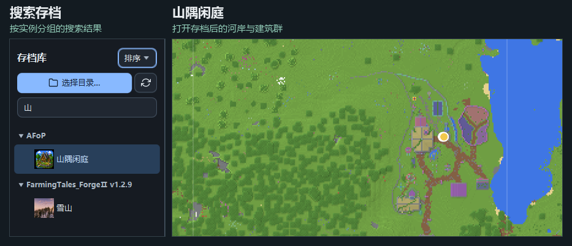

想知道一个老存档保存了多大范围，可以打开「定位 → 查看已保存范围」。在「玩一辈子」的主世界里，MCWE 从 68 个 Region 文件的头表里找到了 23,731 个非空区块位置。蓝色标出已保存范围，彩色部分是当前视口读过的地形。点总览中的位置就能跳回详细地图。

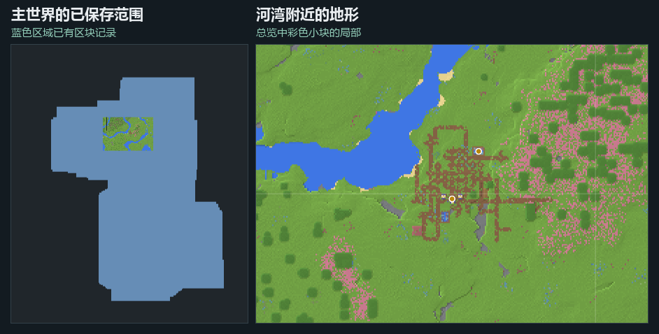

## 看看村庄脚下有什么

打开「图层与标记」，拖动洞穴高度滑块。下图保留了相同的中心和比例尺，左边是村道和农田，右边是滑块放在 Y 20 时显示的 **Y 0–31 高度带**。两个标记点的位置可以用来对照地上和地下。

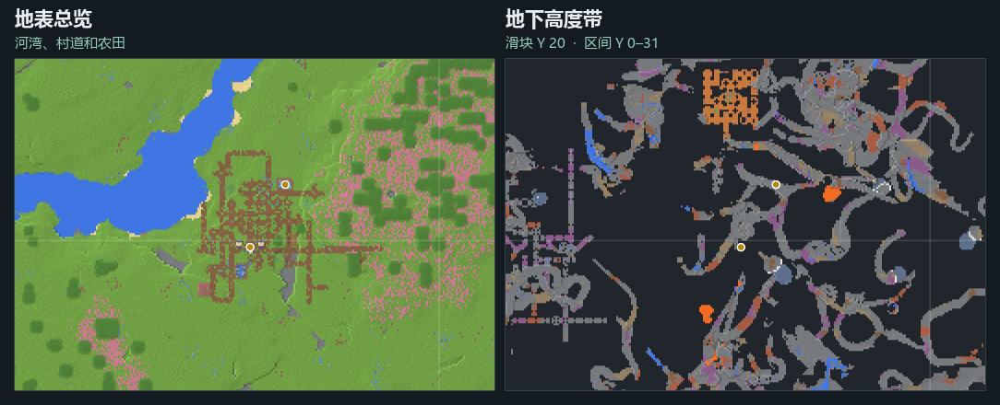

在同一个存档里把「维度」切到下界，地表总览几乎只看得到顶层和传送门标记。把滑块拖到 Y 45，就能看到 **Y 32–63** 之间的地形。下图两幅都围绕同一处下界坐标取景。

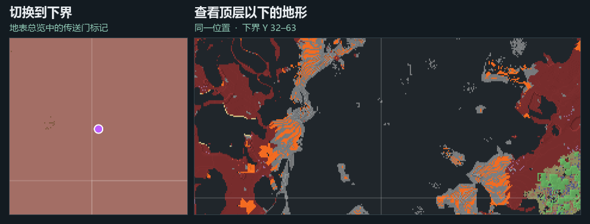

## 标出两个地点，下次还能找到

可以给常去的位置起名，再从一个图标向另一个拖线。松手前，线上方会显示两个方向各差多少格。下图从村庄广场量到北侧农田，X 相差 19 格，Z 相差 34 格。地点和连线保存在便携配置中，重新打开存档仍可回访。

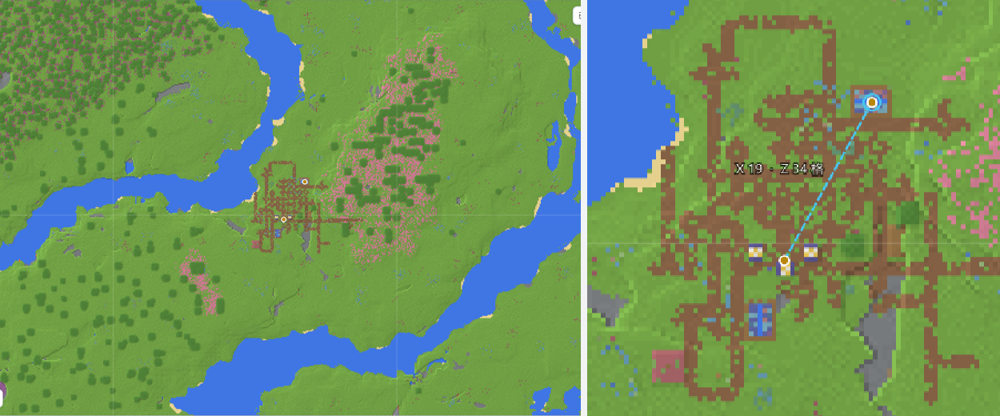

下次只要在「自定义标记点」里搜「农田」，选中结果并按回车，地图就会回到北侧农田的 **X −852、Z −1823**。

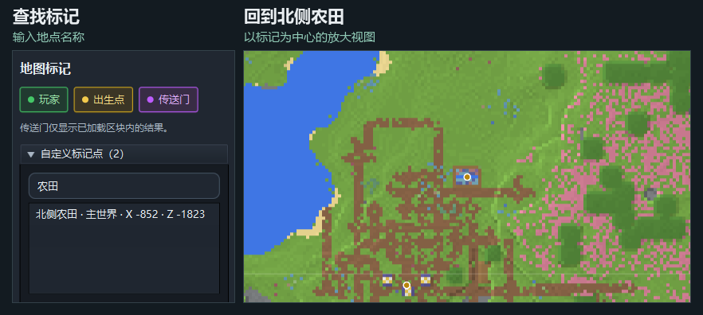

## 把一片地形导出为 PNG

打开「工具 → 导出地图 PNG → 导出指定范围地表」，填写两个对角，就能决定要分享多大的地图。下面从 **(−1060, −1960)** 取到 **(−677, −1641)**，两端都算在内，得到一张每像素对应一个方块的村庄地图。[查看程序直接导出的 PNG 原图](docs/assets/0.7.5/village-export.png)

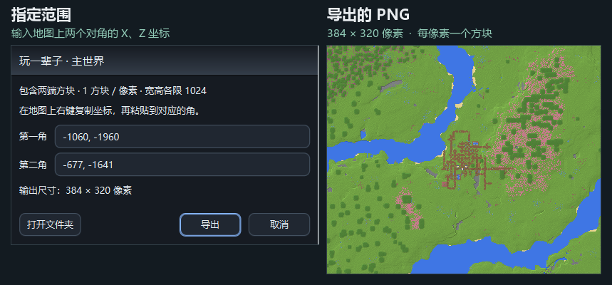

## 用实例自己的资源看建筑

「山隅闲庭」使用另一套实例资源。左边是建筑群在二维地图上的位置，右边是同一片河岸的三维近景。准星指向方块时，可以查看它的 ID、归属和坐标。

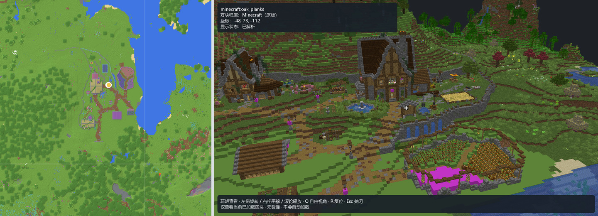

如果模组方块和游戏里看起来不同，打开「资源与插件」可以先核对客户端，再进「解析诊断」按 Mod 查看原因。这次选区里，`chang_sheng_jue:sorghum_block` 的记录是 `UNSUPPORTED_MODEL`，`wenge_leaves` 的记录是 `UNBOUND_TINT`。反馈时可以直接导出这次选区的报告。[资源解析范围](docs/MODEL_PROTOCOL_CAPABILITIES.md)

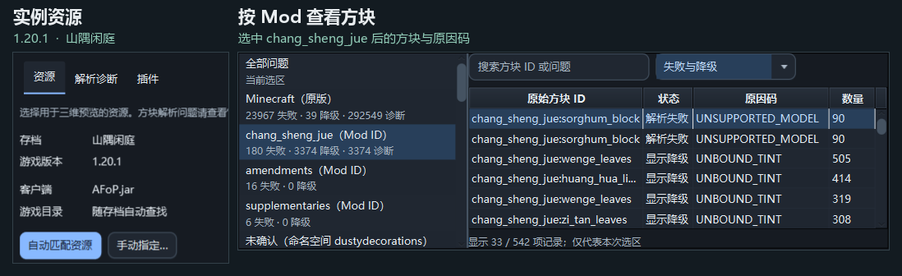

## 用 AI 给自己的整合包补解析规则

你可以请 **DSH、Claude Code 或 Codex** 为三维预览制作独立的解析插件。比如，某种作物使用了 MCWE 尚未识别的模型格式，或者某种树叶缺少有据可查的群系叶色绑定，都可以从一个具体方块开始。

1. 在包含该方块的三维选区打开「资源与插件 → 解析诊断」，导出 JSON，记下想修的方块 ID。
2. 把提示词直接发给能读本地文件、运行 JDK 21 的 Agent，附上诊断 JSON，告诉它便携版和游戏实例的位置。它可以在独立目录里核对资源、编译并交付插件 JAR。程序内也可点「插件开发说明 → 复制全文」获取提示词和接口说明。[复制扩展构建提示词](docs/PLUGIN_DEVELOPMENT.md#agent-prompt)
3. 拿到 JAR 后，在「资源与插件 → 插件 → 安装插件…」安装，勾选后点「应用启停更改」。重新生成**同一选区**，对比目标方块的外观和诊断。缺少的纹理需要先补齐资源，依赖游戏运行时的效果则受当前接口限制。

## 在 Java 项目中接入无 UI 开发者 SDK

核心只读引擎已独立拆分为纯 Java 21 模块 `:mc-world-explorer-sdk`（零 JavaFX 与 OpenGL 依赖），可在命令行工具、存档转换器或服务端批处理程序中直接读取 `1.2.1 – 26.x` Anvil 存档、生成三维体素网格、导出标准 Wavefront `.obj` / `.mtl` / `_atlas.png`（支持无客户端纯色导出及带客户端/实例资源的群系着色与双层遮罩烘焙），或无头渲染二维俯视 PNG 地图。

支持通过 JitPack（Gradle / Maven）按版本标签引入，也可直接使用 Release 附带的独立 SDK JAR。依赖坐标、内置安全边界与完整调用示例见 [SDK 使用指南](docs/SDK_GUIDE.md)。

## 查看显卡，调整内存

「设置 → 渲染」会分别显示当前二维地图和最近一次三维预览使用的设备。拍摄用的电脑列出了 Intel UHD 和 RTX 5060 Laptop 两个二维选项，保存后重启 MCWE 即可应用。三维预览由系统 OpenGL 驱动选卡，这次实际使用的是 RTX 5060 Laptop。

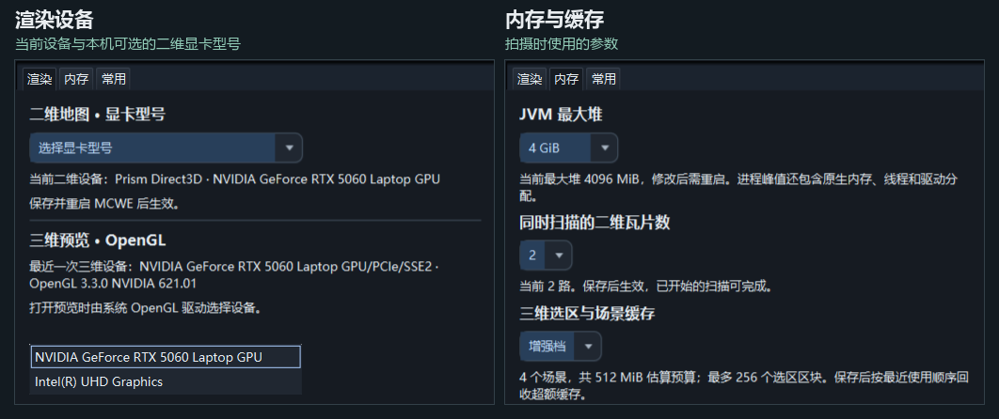

「内存」页可以分别调整 JVM 最大堆、同时扫描的二维瓦片数，以及三维选区与缓存档位。图中的 **4 GiB** 是 JVM 堆上限，整个进程还会使用原生内存。增强档显示的 **512 MiB** 是场景缓存的估算预算。[设备、内存与便携说明](docs/FAQ.md#render-settings)

## 打开自己的存档

1. 下载 Windows x64 便携版 ZIP，完整解压到可写文件夹。双击 `MC World Explorer.exe` 即可启动，包内已带 Java。保留 `app`、`runtime` 与 EXE 的相对位置。[正式发布下载](https://github.com/huang3337/MC-World-Explorer/releases/latest)
2. 点击「选择目录」，选游戏目录、整合包实例、存档目录或单个世界。选择世界后，可切换维度，定位出生点、玩家或已保存的地点。
3. 在「图层与标记」查看地表或指定高度带。需要分享地图时，可导出当前视口，也可以按坐标指定范围导出 PNG。

MCWE 只读浏览已保存的区块。配置、缓存、日志和导出位于便携目录。主界面支持浅色和深色主题。

## 版本支持范围

支持只读浏览 Minecraft Java 版 **Anvil（`.mca`，1.2.1 起）** 存档（含原版维度、数据包自定义维度及传统 `DIM<整数>` 维度）：

| Java 版区间 | 二维地图与高度带 | 三维预览与资源表现 |
|---|---|---|
| **1.20 – 26.x** | 完整支持 | 标准 JSON / 普通 OBJ / Forge & NeoForge 组合模型、已核对客户端世界着色与实例资源包叠加 |
| **1.13 – 1.19.4** | 完整支持 | 标准 JSON 模型、`Level.Biomes` 与数据包群系采样、通用原版着色与气候近似回退 |
| **1.8 – 1.12.2** | 完整支持（含 Forge 数字方块 ID 还原） | 旧版 `textures/blocks`、常见原版状态映射与声明式 `forge_marker: 1` 模型；缺失客户端时回退简化颜色底座 |
| **1.6.1 – 1.7.10** | 完整支持（含 `FML.ItemData` 数字方块 ID 还原） | 常见原版方块静态几何与 `textures/blocks` 贴图合成、无多面歧义简单 Mod 单贴图近似；其余方块回退简化颜色底座 |
| **1.2.1 – 1.5.2** | 完整支持 | 三维简化颜色底座（不解析旧式整张 `terrain.png` 地形图集） |
| **1.1 及更早（`.mcr`）** | 暂不支持 | 暂不支持 |

由于游戏外预览不启动 Minecraft、不执行游戏或 Mod 字节码，不同游戏版本、自定义资源包与整合包 Mod（如复杂实体方块、运行时动态模型、自定义渲染器或未知着色回调）的实际显示效果可能与游戏内存在差异；未能静态还原的方块会保留原始身份、回退为简化颜色，并在「资源与插件 → 解析诊断」中列出具体原因。[详细解析边界](docs/MODEL_PROTOCOL_CAPABILITIES.md)

如果在实际存档或整合包中遇到读取异常、明显的显示偏差或希望补充适配的常见格式，欢迎随时[提交 Issue](https://github.com/huang3337/MC-World-Explorer/issues) 反馈！

## 反馈与许可

反馈问题时，请附应用版本、Minecraft 版本、复现步骤及实际画面。资源问题可以附相关诊断条目，分享前请检查本机路径。[提交 Issue](https://github.com/huang3337/MC-World-Explorer/issues)

项目使用 Java 21、JavaFX 和 LWJGL/OpenGL，采用 GNU GPL v3.0 许可证。[许可证](LICENSE)
